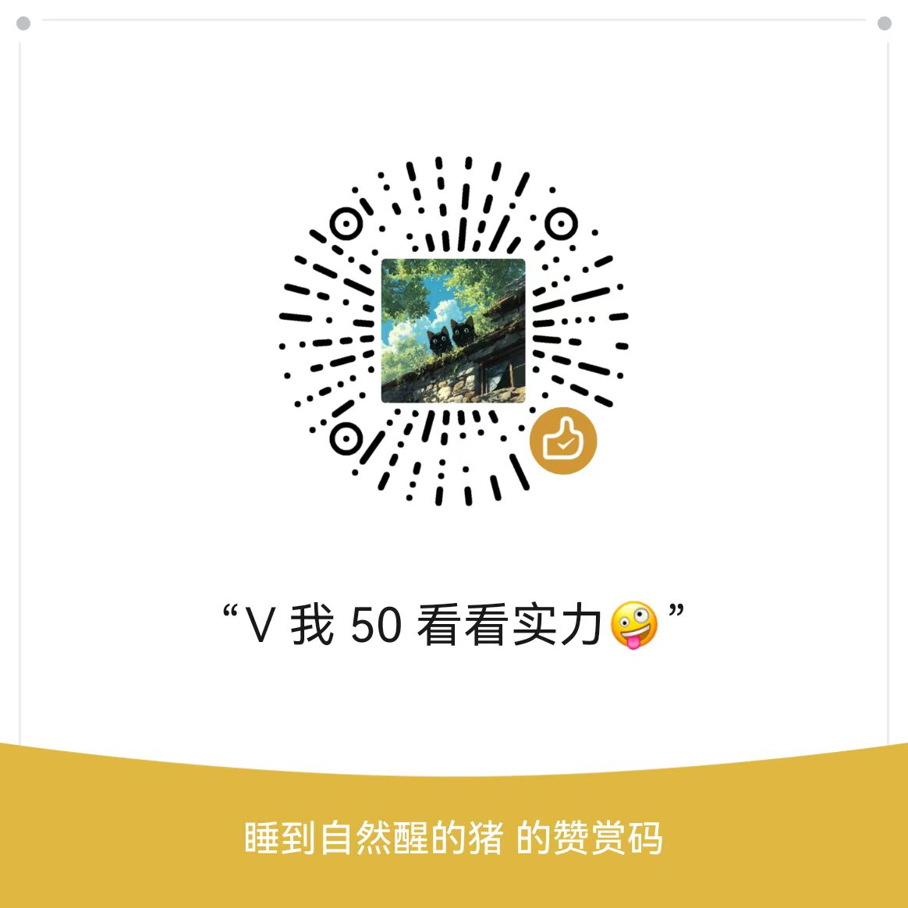

# 沟通的艺术（**`Art-of-Communication`**）

[](https://creativecommons.org/licenses/by/4.0/deed.zh)

> 一个把「书、影、话术」拆成可执行动作的开源笔记库：每一篇笔记都拆成「这是什么 → 为什么有效 → 怎么做 → 怎么验证 → 出错了怎么办」，读完能照着做。

本仓库不是书评影评合集，而是一套**以交付结果为目标的行动手册**。全库共 50 篇笔记，分读书笔记、观影笔记、主题手册三条线：读书/观影笔记逐本独立成文件，主题手册把分散技巧拧成完整动线。

## README · 导览

### README_1 这是什么，与库内体例

本仓库收录**社会心理、沟通表达、亲密关系、个人成长**领域的读书与观影方法笔记，以及在此基础上整理的社交实操手册。每篇笔记自足、格式统一，打开即用，库内体例为：

```
# 《作品名》· 一句话定位
## README · 导览
### README_1 这份笔记解决什么问题
### README_2 阅读路径 / 必须接受的前提
## 板块0 · 学习路径和建议   ← 仅主题手册有此段
### 0_1 学习路径
### 0_2 使用建议与边界声明
## 板块1 · 主题           ← ### 1_1 / 1_2 …… 具体小节
## 板块2 · 主题
```

- 全库每篇篇首为 `## README · 导览`，其下 `### README_1`、`### README_2`…… 给出定位、阅读路径与前提；四部主题手册另有 `## 板块0 · 学习路径和建议`，下设 `0_1 学习路径`、`0_2 使用建议与边界声明`。
- **每篇都配案例小节**：读书/观影笔记统一为「案例小故事」，主题手册为「案例」，说明这一步在什么场合用、会出现什么反应。
- 图示一律以 ASCII 字符图（`plain` 代码块）、LaTeX 公式或缩进文本呈现，**0 张外链图片、0 处图片语法**，离线也不会裂图。
- 时间以相对表述为主（第 1 周 / 30 天 / 3 个月），不写死年份；术语与论点均出自原著/原片公开信息，笔记本身是再加工的方法论，不替代原始作品。

### README_2 目录结构与文件清单

```
Art-of-Communication/
├── docs/
│   ├── 贵气感养成系统手册.md  # 气场与分寸
│   ├── 超级演说家.md          # 表达训练体系
│   ├── 路过你的全世界.md      # 关系与叙事
│   └── 酒桌摇骰子必应攻略.md  # 社交博弈
├── 读书笔记/              # 沟通·亲密·成长主题，逐本独立成文件
├── 观影笔记/              # 按关系发展阶段分组
├── images/              # 图库
├── LICENSE                # CC BY 4.0
└── README.md
```

- 读书笔记 30 篇、观影笔记 16 部、主题手册 4 部，**合计 50 篇**（不含本文件）。
- 仓库中每一篇都是独立文件，未额外打标签或建分类索引页；下方「板块」是按内容编排视角给出的阅读顺序建议。

### README_3 各板块内容速览

| 板块 | 内容 | 篇数 |
| --- | --- | --- |
| 板块1 · 读书笔记（表达与边界 / 亲密关系与情绪 / 自我认知 / 文学叙事 / 说服影响力） | 30 本沟通成长类读物笔记 | 30 |
| 板块2 · 观影笔记（初见 / 错过 / 相守 / 暗面 / 文本细读） | 16 部关系主题影片笔记 | 16 |
| 板块3 · 主题手册 | 贵气感养成 · 超级演说家 · 路过你的全世界 · 酒桌摇骰子 | 4 |

## 板块0 · 学习路径和建议

### 0_1 学习路径

1. **打底（表达与边界）**：先读《非暴力沟通》《好好说话》《身体语言密码》《掌控边界》，建立"怎么说清、怎么守住"的基本功。
2. **深化（亲密关系与情绪）**：再读《爱的艺术》《幸福的婚姻》《情绪勒索》《煤气灯效应》等，把沟通落到关系场景。
3. **内化（自我认知）**：读《被讨厌的勇气》《活出生命的意义》《理解人性》，补上"自己和世界怎么看"的地基。
4. **实操（主题手册）**：最后用《超级演说家》《贵气感养成系统手册》《路过你的全世界》《酒桌摇骰子必应攻略》做专项训练，把方法拧成动线。
5. **观影辅助**：按「初见 → 错过 → 相守 → 暗面」顺序读观影笔记，用影片情节对照笔记里的原理。

> 不必从头读到尾：卡在哪类关系、哪类表达，就直接翻对应篇章；观影笔记可独立按片名查阅。

### 0_2 使用建议与边界声明

- 内容仅供学习与自我训练参考，**不构成心理诊断、医疗建议、婚姻/情感决定依据或任何投资建议**。
- 涉及他人行为解读的部分属于沟通视角而非事实判定；**识别不了真实意图，就不要替对方下结论**。
- 原书与原片的著作权、观点、案例归原作者与权利人所有；本仓库仅对**整理汇编成果**采用 CC BY 4.0（见文末协议）。
- 需说明的是：本仓库全部文件由公开或原始资料收集而来，并经 AI 工具重新归纳、整理与结构化；整体格式与大纲参考了「庚戊学堂」的学习模块组织方式，并在此基础上增补了 README 头部板块。二创请注明出处，商业使用前请自行确认合规。

## 板块1 · 读书笔记

### 1_1 表达与边界

把"怎么说清、怎么拒绝、怎么读懂对方"拆成可执行动作。

- [《非暴力沟通》](<./读书笔记/《非暴力沟通》.md>)
- [《好好说话》](<./读书笔记/《好好说话》.md>)
- [《身体语言密码》](<./读书笔记/《身体语言密码》.md>)
- [《掌控边界》](<./读书笔记/《掌控边界》.md>)
- [《内向者沟通圣经》](<./读书笔记/《内向者沟通圣经》.md>)
- [《倾听孩子》](<./读书笔记/《倾听孩子》.md>)

### 1_2 亲密关系与情绪

关系经营与情绪识别的逐本笔记。

- [《爱的冲突》](<./读书笔记/《爱的冲突》.md>)
- [《爱的艺术》](<./读书笔记/《爱的艺术》.md>)
- [《幸福的婚姻》](<./读书笔记/《幸福的婚姻》.md>)
- [《幸福婚姻的七个原则》](<./读书笔记/《幸福婚姻的七个原则》.md>)
- [《依恋与亲密关系》](<./读书笔记/《依恋与亲密关系》.md>)
- [《亲密关系》](<./读书笔记/《亲密关系》.md>)
- [《亲密关系Ⅱ：无拘无束的关系》](<./读书笔记/《亲密关系Ⅱ：无拘无束的关系》.md>)
- [《情绪勒索》](<./读书笔记/《情绪勒索》.md>)
- [《煤气灯效应》](<./读书笔记/《煤气灯效应》.md>)
- [《爱自己，和谁结婚都一样》](<./读书笔记/《爱自己，和谁结婚都一样》.md>)

### 1_3 自我认知与生命议题

认识自己、安顿意义的笔记。

- [《被讨厌的勇气》](<./读书笔记/《被讨厌的勇气》.md>)
- [《幸福的勇气》](<./读书笔记/《幸福的勇气》.md>)
- [《活出生命的意义》](<./读书笔记/《活出生命的意义》.md>)
- [《自卑与超越》](<./读书笔记/《自卑与超越》.md>)
- [《第二性》](<./读书笔记/《第二性》.md>)
- [《理解人性》](<./读书笔记/《理解人性》.md>)
- [《也许你该找个人聊聊》](<./读书笔记/《也许你该找个人聊聊》.md>)
- [《写给女孩子的幸福忠告》](<./读书笔记/《写给女孩子的幸福忠告》.md>)

### 1_4 文学与人生叙事

以文学与叙事映照沟通与关系。

- [《围城》](<./读书笔记/《围城》.md>)
- [《野兽绅士》](<./读书笔记/《野兽绅士》.md>)
- [《他知道风从哪个方向来》](<./读书笔记/《他知道风从哪个方向来》.md>)
- [《小孩的哲学是大人的解药：丰子恺的人生漫笔》](<./读书笔记/《小孩的哲学是大人的解药：丰子恺的人生漫笔》.md>)
- [《回家的诱惑》](<./读书笔记/《回家的诱惑》.md>)

### 1_5 说服与影响力

影响他人、建立信任的方法。

- [《人性的弱点》](<./读书笔记/《人性的弱点》.md>)

## 板块2 · 观影笔记

### 2_1 初见

关系开端的观察样本。

- [《怦然心动》](<./观影笔记/《怦然心动》.md>)
- [《你的名字。》](<./观影笔记/《你的名字。》.md>)
- [《爱在黎明破晓前》](<./观影笔记/《爱在黎明破晓前》.md>)
- [《喜欢·你》](<./观影笔记/《喜欢·你》.md>)

### 2_2 错过

关系中的遗憾与错位。

- [《后来的我们》](<./观影笔记/《后来的我们》.md>)
- [《从你的全世界路过》](<./观影笔记/《从你的全世界路过》.md>)
- [《前任攻略》](<./观影笔记/《前任攻略》.md>)
- [《致我们终将逝去的青春》](<./观影笔记/《致我们终将逝去的青春》.md>)
- [《现在去见你》](<./观影笔记/《现在去见你》.md>)

### 2_3 相守

长期关系与磨合。

- [《七月与安生》](<./观影笔记/《七月与安生》.md>)
- [《北京遇上西雅图》](<./观影笔记/《北京遇上西雅图》.md>)
- [《时空恋旅人》](<./观影笔记/《时空恋旅人》.md>)
- [《恋恋笔记本》](<./观影笔记/《恋恋笔记本》.md>)

### 2_4 暗面

关系中的控制、博弈与失控。

- [《花束般的恋爱》](<./观影笔记/《花束般的恋爱》.md>)
- [《无耻之徒》](<./观影笔记/《无耻之徒》.md>)

### 2_5 文本细读

从叙事结构与镜头语法做方法拆解。

- [《恋空》](<./观影笔记/《恋空》.md>)

## 板块3 · 主题手册

### 3_1 贵气感养成系统手册

气场与分寸的系统训练：从底层认知到日常举止的整套动线。

- [《贵气感养成系统手册》](<./docs/贵气感养成系统手册.md>)

### 3_2 超级演说家

从底层认知到四阶段训练、再到控场复盘的表达训练体系。

- [《超级演说家》](<./docs/超级演说家.md>)

### 3_3 路过你的全世界

关系与叙事的综合手册，把沟通落到真实相处场景。

- [《路过你的全世界》](<./docs/路过你的全世界.md>)

### 3_4 酒桌摇骰子必应攻略

社交博弈与酒桌场景的实操手册。

- [《酒桌摇骰子必应攻略》](<./docs/酒桌摇骰子必应攻略.md>)

## 请我喝杯咖啡

|     微信赞赏码     |       支付宝        |       支付宝红包        |
| :----------------: | :-----------------: | :-----------------: |
|  | | |

## 协议（CC BY 4.0）

### 协议摘要

> 本仓库整理内容采用 **CC BY 4.0（知识共享署名 4.0 国际许可协议）**。
> 您可以自由分享、改编本仓库整理的资料（含商业使用）；分发、二次加工时须**标注来源（BY）**。所引原著、影片、工具书内容的著作权归原作者与权利人所有，协议仅适用于本仓库的整理汇编成果。

### 完整协议

[CC BY 4.0 知识共享署名 4.0 国际许可协议](https://creativecommons.org/licenses/by/4.0/deed.zh) · 全文见仓库根目录 [LICENSE](LICENSE)
